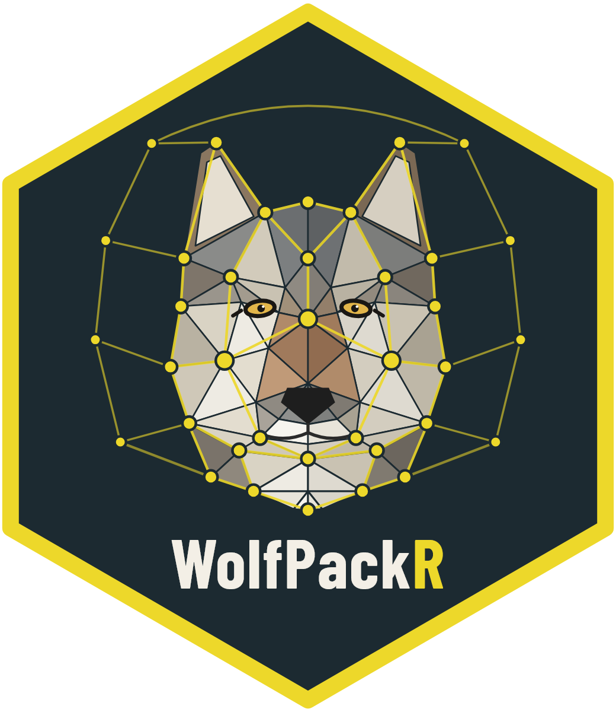

<!-- README.md is generated from README.Rmd. Please edit that file -->

# WolfPackR 

<!-- badges: start -->

<!-- badges: end -->

WolfPackR identifies wolf packs, and the status of each individual, from
genetic relatedness and the locations of non-invasive genetic samples
(scats, urine, hair…). The typical workflow:

1.  `relatedness()` and `genetic_groups()`: families, found by community
    detection on the relatedness graph;
2.  `space_use()`: space use of each individual by kernel density, on a
    common grid with a common bandwidth, so that individuals with one or
    two samples are handled like the others;
3.  `assign_individuals()`: each individual goes to the territory where
    most of its samples fall, and gets a status (Resident, Putative
    disperser, Disperser, Unrelated resident, Transient, Undetermined);
4.  `spatial_groups()`: families spread over several territories are
    split into spatially coherent packs.

`wolf_packs()` runs the four steps in one call. `summarise_packs()`,
`plot_packs()` and `pack_timeline()` describe the packs (composition,
territories, kinship) and follow them through sampling periods (land
tenure); `compare_partitions()` and `pack_stability()` assess them
against a reference and test their robustness. The package comes with
the data of a survey of wolves in the Romanian Carpathians (Foundation
Conservation Carpathia; Iosif et al., 2025).

## Installation

You can install the development version of WolfPackR from
[GitHub](https://github.com/) with:

``` r
remotes::install_github("eboncourt/WolfPackR")
```

## Example

``` r
library(WolfPackR)
data("samples_Carpathians"); data("genotypes_Carpathians")
rel <- relatedness(genotypes_Carpathians, freq_ids = setdiff(genotypes_Carpathians$Individual, "EF.15J8"))
res <- wolf_packs(samples_Carpathians, rel, estimator = "QG", threshold = 0.25, period = "Campaign")
res
plot_packs(res$samples, "Pack", ud = res$ud)
```
